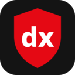

<p align="center"></p>
<h1 align="center">dx.block</h1>
<p align="center">A fast, thorough, open-source ad blocker for <b>Brave</b>, Chrome and every Chromium browser (Manifest V3).</p>

---

dx.block takes the filter lists behind **uBlock Origin**, **AdGuard** and **Adblock Plus** and compiles them into
Chrome's native blocking engine, then adds the parts that engine can't do on its own: cosmetic filtering,
scriptlets, a pop-up blocker and an element picker.

## Features

- **Network blocking**: ads, trackers, malware and scam domains, using Chrome's built-in `declarativeNetRequest` engine (no request ever passes through extension code)
- **Cosmetic filtering**: hides leftover ad boxes; generic rules are matched lazily (uBO-style) so pages never parse tens of thousands of selectors
- **Procedural filters**: `:has-text()`, `:upward()`, `:remove()`, `:xpath()` and more, via AdGuard ExtendedCss
- **Scriptlets**: the same anti-adblock / YouTube defusers uBlock Origin and AdGuard use (AdGuard Scriptlets), injected before page scripts
- **Surrogates**: ad scripts that sites depend on are swapped for harmless stand-ins instead of breaking the page
- **Pop-up blocking**: closes ad pop-ups using EasyList's `$popup` filters, any pop-up to 60k known ad / scam / malware domains, and pop-ups opened by ad iframes
- **Cookie banners & nag pop-ups**: uBlock and AdGuard annoyance lists, on by default
- **Dangerous-page warning**: scam and malware pages are replaced by a dx.block warning with *Go back* / *Proceed anyway*
- **Live dashboard**: an animated scanner popup with per-page counts (ads, trackers, hidden elements, pop-ups), a live feed of what's being blocked, and a toolbar badge
- **MV3 gap fillers**: uBO HTML filters (`##^script:has-text`) run as `remove-node-text` scriptlets, `redirect-rule`s and `example.*` domains are converted, `:matches-path()` is evaluated at navigation, and ad-domain XHRs are hard-blocked except for ad *scripts*, which keep uBO's stealth empty response so anti-adblock walls stay quiet
- **Tracking-parameter stripping**: removes `fbclid`, `gclid` and hundreds more from links
- **Element picker**: right-click → *Block element…*, choose how specific the rule should be, done
- **Per-site switch**, custom filters (ABP / uBO / AdGuard syntax) and an allowlist

### Filter lists

| On by default | Optional |
|---|---|
| EasyList · EasyPrivacy · uBlock filters, quick fixes, unbreak, privacy, badware, cookie notices, annoyances · AdGuard Base, URL Tracking, cookie notices · Peter Lowe's list · HaGeZi Multi PRO · Malicious URL Blocklist · dx.block fixes | Fanboy's Annoyance |

## Results

Automated tests (`npm test`) load the extension in a clean Chromium and check real pages:

- adblock.turtlecute.org: **132 / 132**
- YouTube: ad placements removed from the player response
- Generic, specific and late-inserted ads hidden; real content untouched
- Pop-ups to ad domains closed; scam pages show the warning page; `fbclid`/`gclid` stripped
- Blocked counter, toolbar badge and hidden-element count; allowlist, custom filters and picker work

## Install

**From a release:** download `dxblock-x.y.z.zip` from [Releases](../../releases), unzip it, open `brave://extensions`,
switch on **Developer mode**, click **Load unpacked** and pick the unzipped folder.

**From source:**
```bash
npm ci
npm run build        # downloads the lists and builds dist/
npm test             # optional: end-to-end tests in Chromium (needs: npx playwright install chromium)
npm run package      # dxblock-<version>.zip for the Chrome Web Store
```
Then load `dist/` unpacked as above.

## How it works

| Piece | Where |
|---|---|
| Filter compiler (ABP / uBO / AdGuard → DNR + cosmetic + scriptlet data) | `src/lib/filters.js` (shared by the build and the extension) |
| Build: download lists, compile, bucket per-site data, write rulesets | `tools/build.mjs`, list catalog in `tools/lists.mjs` |
| Service worker: settings, per-site cosmetics at navigation, pop-up blocker, user filters | `src/background.js` |
| Lazy generic hiding | `src/content/cosmetic.js` |
| Element picker | `src/content/picker.js` |

Lists ship inside the extension (Manifest V3 doesn't allow remote rule updates for static rules), so the
GitHub Action rebuilds with fresh lists every week and publishes a release.

## Privacy

dx.block collects nothing and sends nothing anywhere. See [PRIVACY.md](PRIVACY.md).

## Credits & license

dx.block is free software under the **GNU GPL v3** ([LICENSE](LICENSE)). It stands on the work of:

- [EasyList & EasyPrivacy](https://easylist.to/): GPL-3.0 / CC BY-SA 3.0
- [uBlock Origin filter lists](https://github.com/uBlockOrigin/uAssets): Raymond Hill & contributors, GPL-3.0
- [AdGuard filters](https://github.com/AdguardTeam/AdguardFilters), [Scriptlets](https://github.com/AdguardTeam/Scriptlets) and [ExtendedCss](https://github.com/AdguardTeam/ExtendedCss): AdGuard, GPL-3.0
- [HaGeZi DNS blocklists](https://github.com/hagezi/dns-blocklists): GPL-3.0
- [Peter Lowe's list](https://pgl.yoyo.org/adservers/) · [Malicious URL Blocklist](https://gitlab.com/malware-filter/urlhaus-filter) (CC0 / MIT) · [Fanboy's lists](https://secure.fanboy.co.nz/) (CC BY 3.0)

dx.block isn't affiliated with any of these projects.
