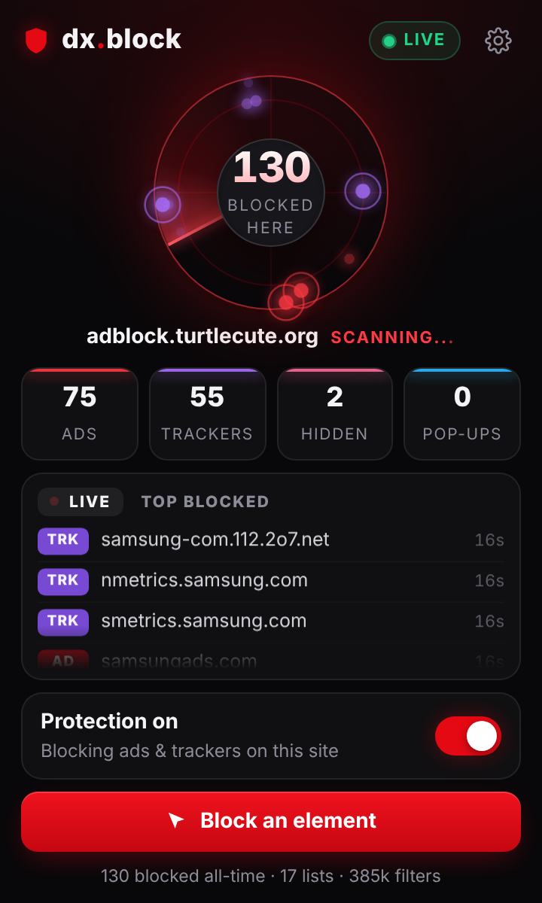
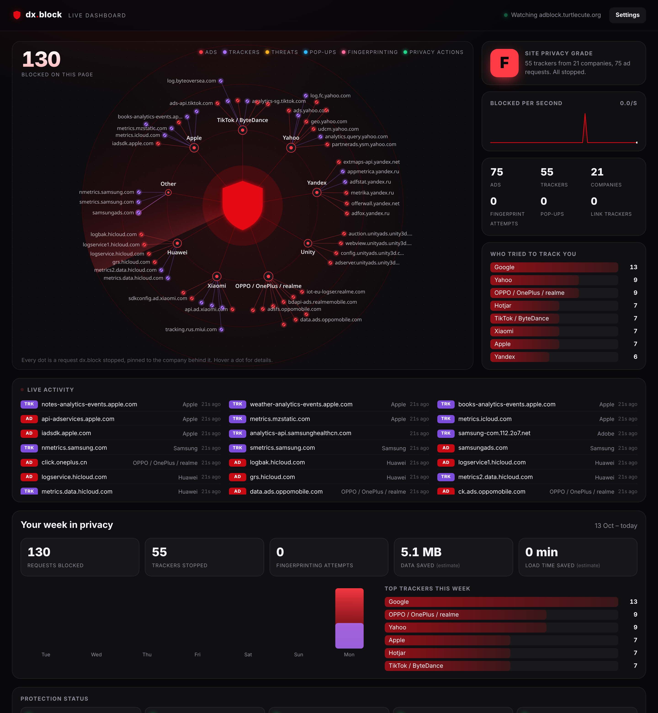
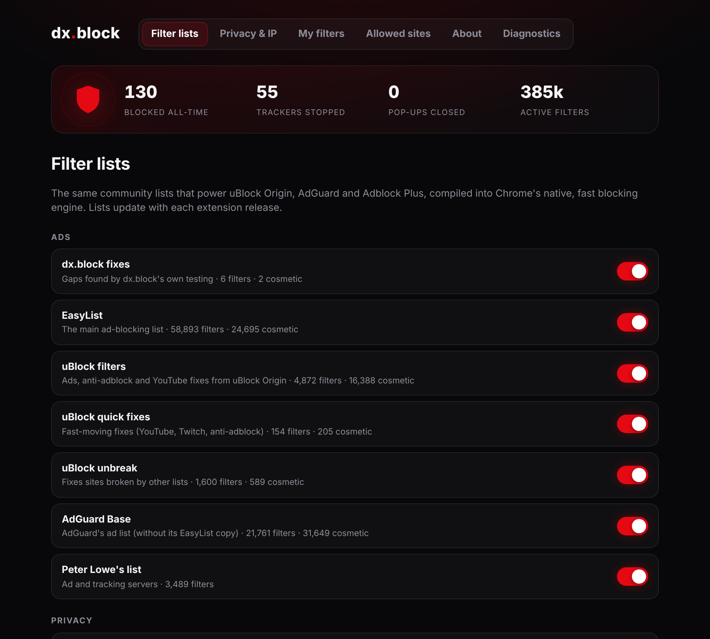
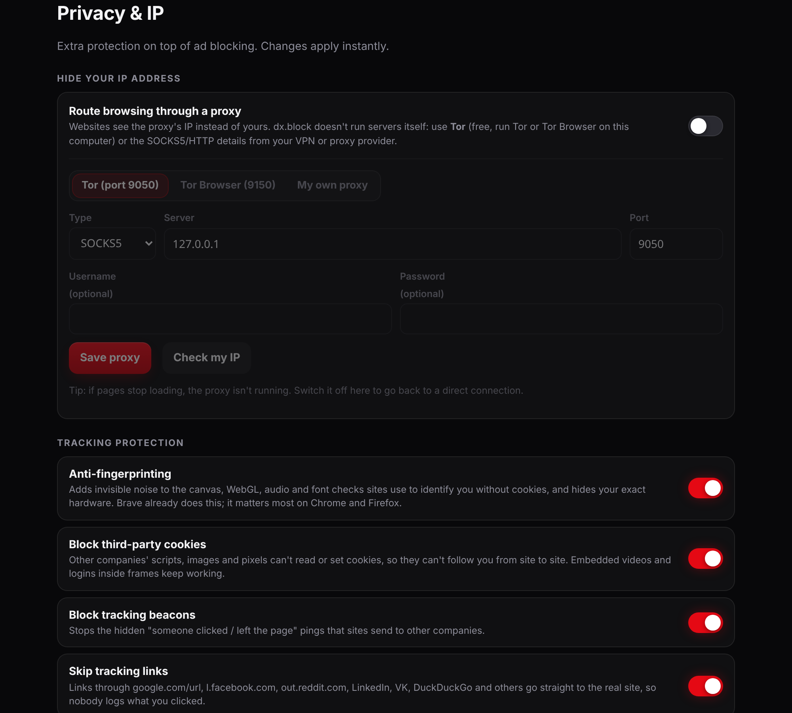
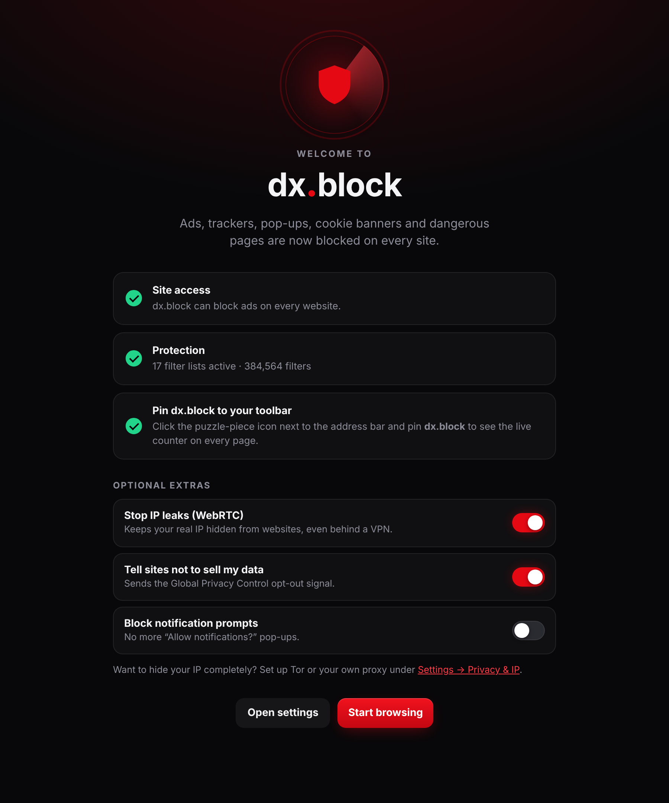
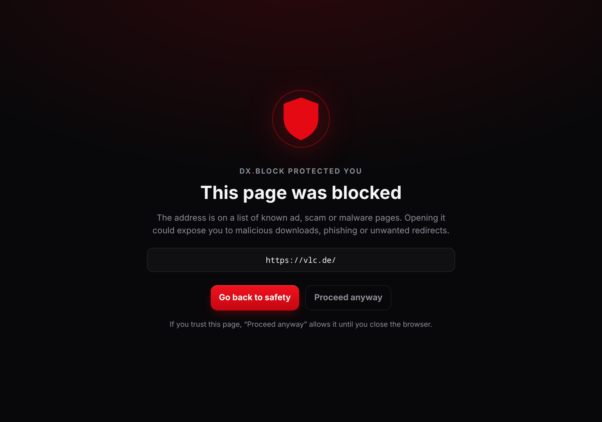

<!-- Header: the same wave as github.com/notdxbi -->
<p align="center">
  
</p>

<p align="center">
  
</p>

<p align="center">
  <a href="../../releases/latest"><b>⬇ Download dx.block</b></a>
  &nbsp;·&nbsp;
  <a href="https://discord.gg/nnVBjqZ84F"><b>💬 Join the Discord</b></a>
  &nbsp;·&nbsp;
  <a href="https://buymeacoffee.com/notdxbi"><b>☕ Support dx.bi</b></a>
</p>

<p align="center">
  <a href="../../releases/latest"></a>
  
  
  
  <a href="LICENSE"></a>
  <a href="https://discord.gg/nnVBjqZ84F"></a>
  <a href="https://buymeacoffee.com/notdxbi"></a>
</p>

<p align="center"></p>

---

## How it compares

Measured on 2026-10-19 with each extension loaded into a clean Chromium at its **default settings**, using the two
most popular public ad-block tests. Anyone can reproduce this: `node tools/test.mjs` runs the same checks.

| | **dx.block** | uBlock Origin Lite | AdGuard (MV3) | No blocker |
|---|:---:|:---:|:---:|:---:|
| [superadblocktest.com](https://superadblocktest.com/) protection score | **100%** | 70% | 42% | 11% |
| superadblocktest.com raw block rate (482 probes) | **100%** | 72% | 38% | 13% |
| [adblock.turtlecute.org](https://adblock.turtlecute.org/) | **132 / 132** | 83 / 132 | 29 / 132 | 9 / 132 |

<sub>uBlock Origin Lite 2026.1018.2229 and AdGuard 5.5.3.3 (MV3) were installed from their official GitHub releases.
Store installs may enable more after their first-run setup. Scores test known ad/tracker hosts and bait elements;
no test proves every ad on every site is gone.</sub>

**Why it scores higher:** dx.block doesn't pick one company's filter list. It merges the lists behind
**uBlock Origin, AdGuard, Adblock Plus (EasyList) and HaGeZi**, plus its own strict and fix-up lists, and compiles them all
into the browser's native blocking engine. It also closes the gaps Manifest V3 leaves open (see below). It has no
"acceptable ads" programme, no paid tier, no account and no tracking of its own.

## Features

**Blocking**
- Ads, trackers, analytics, social pixels, telemetry, malware and scam domains, about **385,000 filters** active by default
- **Pop-ups and pop-unders**: closed using EasyList's pop-up filters, 60,000 known ad/scam domains, and pop-ups opened by ad frames
- **Cookie banners and nag pop-ups** gone (uBlock and AdGuard annoyance lists)
- **YouTube and anti-adblock walls**: defused with the same scriptlets uBlock Origin and AdGuard use
- **Dangerous pages** are replaced by a warning screen with *Go back* and *Proceed anyway*
- **Link tracking** (`fbclid`, `gclid` and 300+ others) stripped from URLs
- **Element picker**: right-click → *Block element…* to remove anything permanently

**Privacy**
- **Anti-fingerprinting**: invisible noise on canvas, WebGL, audio and font checks, plus generic hardware values, so sites can't identify you without cookies
- **Third-party cookies and tracking beacons blocked**, so ad companies can't follow you between sites
- **Tracking links skipped**: `google.com/url`, `l.facebook.com`, `out.reddit.com`, LinkedIn, VK, DuckDuckGo and more go straight to the real page; AMP pages open as the original
- **Global Privacy Control / Do Not Track** opt-out signal
- Optional: **Blend in** (sites see UTC and US English), strip third-party referrers, **forget sites when you leave** (cookies and storage deleted when the last tab closes, with a keep list)

**Safety**
- **Fake-site warnings**: look-alike domains imitating PayPal, banks, Microsoft, Steam, Discord and 90 more brands, including Cyrillic look-alike letters and `paypal.com.scam.xyz` tricks
- **Phishing blocklist** (30,000 active phishing sites) and a malware URL list, with a warning screen
- Warning before you type a password on an unencrypted page; optional **HTTPS-only** with automatic fallback
- **Hide your IP** through Tor or your own SOCKS5/HTTP proxy or VPN (with *Check my IP*), and **WebRTC leak protection**
- **Site permissions** at a glance (camera, microphone, location, notifications) with one-click revoke

**See what's happening**
- **Live tracker web** in the popup: every blocked request flies in, gets grabbed and is pinned to the company behind it (Google, Meta, Amazon, TikTok…), plus a blocked-per-second chart
- **Privacy grade** (A–F) for each site, counts for ads, trackers, companies, fingerprinting attempts and hidden elements, a live feed and a company breakdown
- **Full-screen dashboard** with a large labelled tracker map, live chart, "who tried to track you", protection status and a **weekly privacy report**
- **Report a problem** button that opens a pre-filled GitHub issue (nothing is sent unless you submit it)
- **Fast fixes**: a small fix list in this repo is fetched a few times a day, so new ads get fixed without waiting for a release
- Optional **SponsorBlock**: skip sponsor segments on YouTube (privacy-preserving hash-prefix lookups)
- Toolbar badge, all-time stats, one-click switch per site, custom filters (ABP / uBO / AdGuard syntax), allowlist, Diagnostics page

<p align="center"></p>

<p align="center"> </p>
<p align="center"> </p>

## Install

Download the [latest release](../../releases/latest).

**Brave · Chrome · Edge · Opera · Vivaldi**
1. Download `dxblock-<version>-chromium.zip` and unzip it somewhere permanent
2. Open `brave://extensions` (or `chrome://extensions`, `edge://extensions`) and switch on **Developer mode**
3. Click **Load unpacked**, pick the unzipped folder, then pin dx.block to the toolbar

**Firefox (128+)**
- If the release has `dxblock-<version>-firefox.xpi`, open it in Firefox to install. It's signed by Mozilla and **updates itself**.
- Otherwise use `about:debugging` → *This Firefox* → *Load Temporary Add-on* with the `-firefox.zip`.

**Updates.** Filter lists are rebuilt every Monday and published as a new release. Signed Firefox builds update
automatically; on Chromium browsers dx.block shows an "Update available" banner in its popup when a new release is out
(Chrome-family browsers only auto-update extensions installed from the Chrome Web Store).

## What MV3 extensions normally can't block, and how dx.block handles it

| Gap | What dx.block does |
|---|---|
| uBlock HTML filters (`##^script:has-text`) can't run in Manifest V3 | Converted to AdGuard's `remove-node-text` scriptlet, which strips matching inline scripts as the page loads |
| `$popup` filters aren't supported by the browser's blocking API | Ad pop-ups are detected and closed by the extension |
| `redirect-rule`, `domain=example.*`, `:matches-path()` filters are dropped by most converters | Converted or evaluated at navigation time |
| Lists answer ad requests with fake "empty" responses (stealth), which tests and some trackers see as allowed | Real blocks for everything except the ad scripts that anti-adblock walls check for |
| Social SDKs, chat widgets and product analytics are allow-listed to avoid breakage | Blocked as third-party by the **dx.block strict** list (their own sites keep working) |
| Chrome applies one URL-cleaning rule per request | Parameter-stripping rules are merged so every tracking parameter goes in one pass |

Still impossible for any extension: ads stitched into the video stream server-side (some YouTube ads), sponsor
segments read out by creators, and first-party ads with no fixed pattern that no list has a rule for yet.

## Build from source

```bash
npm ci
npm run build          # downloads the latest lists -> dist/ (Chromium) and dist-firefox/
npm test               # end-to-end tests in Chromium (npx playwright install chromium); --brave for Brave
node tools/test-firefox.mjs   # Firefox test (real Firefox, temporary add-on)
npm run package        # store zips
```

| Piece | Where |
|---|---|
| Filter compiler (ABP / uBO / AdGuard → declarativeNetRequest + cosmetic + scriptlets) | `src/lib/filters.js` |
| Build, list catalog, own lists | `tools/build.mjs`, `tools/lists.mjs`, `tools/fixes.txt`, `tools/strict.txt` |
| Service worker: blocking setup, cosmetics, pop-ups, stats, tweaks | `src/background.js`, `src/stats.js` |
| Popup, settings, welcome page, element picker | `src/popup`, `src/options`, `src/welcome`, `src/content` |

## About

dx.block is an independent project by [dx.bi](https://github.com/notdxbi), built with the help of [Claude Code](https://www.anthropic.com/claude-code), Anthropic's AI coding assistant. Bug reports, filter fixes and pull requests are welcome: use the **Report** button in the popup or [open an issue](../../issues/new/choose). Questions and ideas go in [Discussions](../../discussions).

## Privacy

dx.block collects nothing. No accounts, no analytics, no telemetry. See [PRIVACY.md](PRIVACY.md).

## Credits & license

dx.block is free software under the **GNU GPL v3** ([LICENSE](LICENSE)), built on the work of:
[EasyList & EasyPrivacy](https://easylist.to/) ·
[uBlock Origin filters](https://github.com/uBlockOrigin/uAssets) (Raymond Hill & contributors) ·
[AdGuard filters](https://github.com/AdguardTeam/AdguardFilters), [Scriptlets](https://github.com/AdguardTeam/Scriptlets) and [ExtendedCss](https://github.com/AdguardTeam/ExtendedCss) (AdGuard) ·
[HaGeZi DNS blocklists](https://github.com/hagezi/dns-blocklists) ·
[Peter Lowe's list](https://pgl.yoyo.org/adservers/) ·
[Malicious URL Blocklist](https://gitlab.com/malware-filter/urlhaus-filter) ·
[Fanboy's lists](https://secure.fanboy.co.nz/).
dx.block isn't affiliated with any of these projects or with the other blockers named above.

---

<p align="center">
  <sub>Part of the <b>dx.bi</b> family: <a href="https://github.com/notdxbi/dxbi-stremio">dx.bi</a>, the Netflix-style streaming app · <b>dx.block</b> · more on <a href="https://github.com/notdxbi">github.com/notdxbi</a></sub>
</p>

<p align="center">
  
</p>
